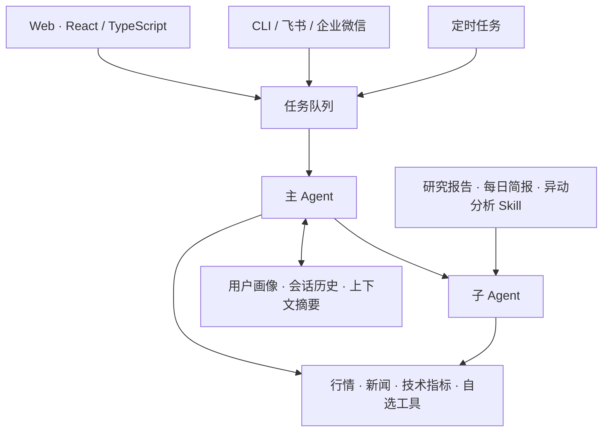

# 股伴 StockMate

面向个人的 A 股研究 Agent。通过自然语言调用行情、新闻与技术分析工具，结合用户偏好完成股票研究、生成报告和安排定时任务。

## 功能

- **股票研究**：查询实时行情、历史 K 线和新闻，计算技术指标，分析个股走势与异动。
- **市场观察**：查看市场涨跌分布、涨跌停数量、市场情绪和热门股票，按条件筛选研究标的。
- **自选管理**：通过对话维护自选股，查看股票名称、代码和关注备注。
- **Skill 分析**：主 Agent 委派子 Agent，执行研究报告、每日简报和异动分析。
- **长期记忆**：保存投资风格、风险偏好和关注行业，自动整理长对话，恢复会话历史与摘要。
- **定时研究**：通过网页或自然语言创建单次、每天、工作日任务，支持查询、暂停、启用和删除，结果回到聊天。
- **多端交互**：支持 Web、CLI、飞书和企业微信，网页展示工具调用与任务执行状态。

## 架构



后端使用 Python 和 aiohttp，提供 Agent 接口与前端静态服务；前端使用 React、TypeScript 和 Vite，通过 SSE 接收执行状态。用户画像、会话和定时任务使用本地文件持久化。

## 快速开始

环境：Python 3.12、Node.js 22+。

### 1. 安装依赖

```powershell
git clone https://github.com/XUhy299/stockmate.git
cd stockmate
python -m venv venv
.\venv\Scripts\python.exe -m pip install -r requirements.txt
npm --prefix front ci
Copy-Item .env.example .env
```

### 2. 配置模型

在 `.env` 中配置 OpenAI 兼容模型服务：

```dotenv
OPENAI_API_KEY=your-api-key
OPENAI_API_BASE=https://your-provider.example/compatible-mode/v1
OPENAI_MODEL=qwen3.8-flash
```

更多模型参数和飞书、企业微信配置见 [.env.example](.env.example)。使用飞书时安装 `lark-oapi`。

### 3. 启动 Web

```powershell
npm --prefix front run build
.\venv\Scripts\python.exe main.py --web
```

访问 **http://127.0.0.1:8088**。完成构建后，也可以通过 `start-web.bat` 启动。

### 其他启动方式

```powershell
# 命令行交互
.\venv\Scripts\python.exe main.py --cli

# Web + 固定早报与交易时段监控
.\venv\Scripts\python.exe main.py --web --schedule

# 指定会话
.\venv\Scripts\python.exe main.py --web --session research
```

用户创建的定时任务随 Web 服务自动调度，按北京时间执行；`--schedule` 额外开启固定早报与行情监控。

## 致谢

- [nanobot](https://github.com/HKUDS/nanobot)：Agent 循环与文件记忆设计参考。
- [AKShare](https://github.com/akfamily/akshare)：财经数据接口。

## 许可证

MIT License
